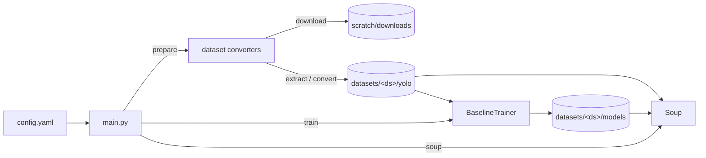
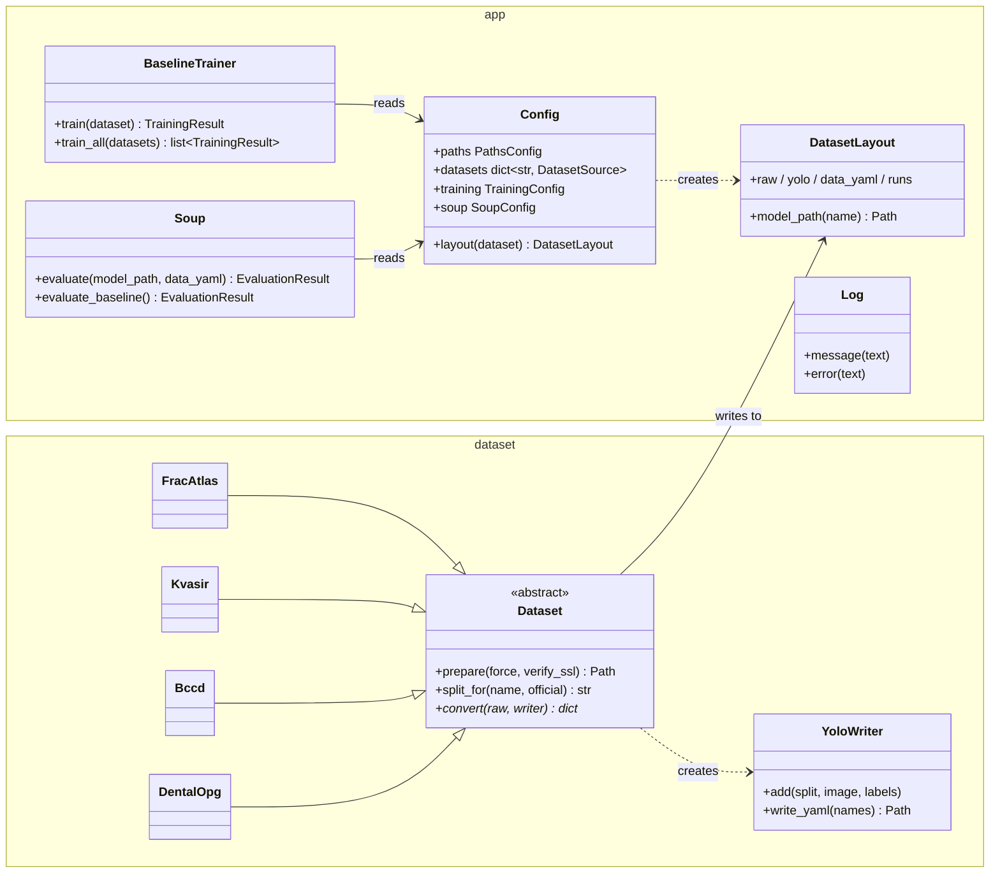

# Soup

## Overview

Soup is an experiment framework for *model soups* (averaging the weights of
several fine-tuned models) for Ultralytics YOLO object detectors. It downloads
example medical-imaging datasets, converts them to Ultralytics format, trains
a baseline detector per dataset, and evaluates the baseline that the soup
starts from. Weight averaging itself is not implemented yet.

The four bundled datasets are examples; any dataset can be added by writing a
converter (see [Adding a dataset](#adding-a-dataset)).

## Requirements

- Python 3.15 in the `soup` conda environment.
- An NVIDIA GPU with CUDA for training (`training.device` in `config.yaml`).
- Pinned Python libraries are listed in `requirements.txt` (Ultralytics, PyTorch, PyYAML, certifi).
- Git LFS, if model or image files are ever committed (`.gitattributes` routes them to LFS).

## Setup

```bash
conda create -n soup python=3.15
conda activate soup
python -m pip install -r requirements.txt
git lfs install   # once per machine
```

## How to run

All commands run from the project root through `main.py`. Either activate the
environment (`conda activate soup`, then `python main.py ...`) or use
`conda run --no-capture-output` as below. Plain `conda run` holds back all
output until the command exits, so a long training run looks like it hangs.

```bash
conda run --no-capture-output -n soup python main.py prepare   # download and convert all datasets
conda run --no-capture-output -n soup python main.py train     # train baselines for training.datasets
conda run --no-capture-output -n soup python main.py soup      # evaluate the soup baseline
```

Every command loads `config.yaml` first and logs it. All messages use the
format `[module] message`.

Outputs go under `scratch/` (git-ignored):

| Path | Contents |
|---|---|
| `scratch/downloads/` | Downloaded dataset archives |
| `scratch/weights/` | Pretrained Ultralytics weights (downloaded on first use) |
| `scratch/datasets/<dataset>/raw/` | Extracted archive |
| `scratch/datasets/<dataset>/yolo/` | Ultralytics dataset (`data.yaml`, `train/`, `val/`, `test/`) |
| `scratch/datasets/<dataset>/runs/<run_name>/` | Ultralytics training run (logs, plots, `weights/best.pt`) |
| `scratch/datasets/<dataset>/models/<run_name>.pt` | Published copy of the run's best checkpoint |

## Programs and command-line parameters

`main.py` is the only entry point. Its global option comes before the subcommand:

| Flag | Type | Required | Default | Description |
|---|---|---|---|---|
| `--config` | path | optional | `config.yaml` beside `main.py` | Configuration file; relative paths inside it resolve against its directory |

### `main.py prepare`

Downloads each dataset archive, extracts it to `raw/`, and converts it to
Ultralytics format in `yolo/`. An already prepared dataset is skipped. The
output directory is always rebuilt from empty, and an interrupted download or
extraction is redone automatically.

| Flag | Type | Required | Default | Description |
|---|---|---|---|---|
| `--dataset NAME` | string, repeatable | optional | every key under `datasets` | Dataset(s) to prepare |
| `--force` | flag | optional | off | Download again and rebuild from scratch |
| `--insecure` | flag | optional | off | Disable SSL certificate verification for the download |

```bash
conda run --no-capture-output -n soup python main.py prepare
conda run --no-capture-output -n soup python main.py prepare --dataset bccd --dataset kvasir
conda run --no-capture-output -n soup python main.py prepare --dataset fracatlas --force
```

Some dataset hosts (Kvasir in particular) can fail SSL verification behind
some networks. Use `--insecure` only if you trust the network, or set
`verify_ssl: false` for that dataset in `config.yaml`.

### `main.py train`

Trains a baseline detector for each selected dataset and logs a summary. For
each dataset it reports the epoch-1 val mAP50-95 and the train and val
mAP50-95 of the final `best.pt`, both measured on the same checkpoint. The run
trains into `runs/<run_name>-incomplete/`. Only after it succeeds does it
replace `runs/<run_name>/` and `models/<run_name>.pt`, so a failed run never
destroys an earlier baseline. One failed dataset does not stop the others. The
exit code is non-zero if any dataset failed.

| Flag | Type | Required | Default | Description |
|---|---|---|---|---|
| `--dataset NAME` | string, repeatable | optional | `training.datasets` (or every dataset if that is empty) | Dataset(s) to train |

```bash
conda run --no-capture-output -n soup python main.py train
conda run --no-capture-output -n soup python main.py train --dataset dental_opg
```

### `main.py soup`

Validates the configured baseline model on its dataset's val split. It uses
the training `imgsz`, `batch`, `device` and `workers`, then logs the overall
and per-class mAP50-95.

```bash
conda run --no-capture-output -n soup python main.py soup
```

### Configuration (`config.yaml`)

Unknown keys are rejected, so typos fail early.

| Section | Key | Meaning |
|---|---|---|
| `paths` | `downloads`, `datasets`, `weights` | Storage directories (see the outputs table above) |
| `datasets.<name>` | `url` | Archive download URL |
| | `verify_ssl` | Optional, default `true`; overridden by `prepare --insecure` |
| `training` | `model` | Pretrained model; a bare `*.pt` name is stored in `paths.weights` |
| | `optimizer`, `lr0`, `epochs`, `patience`, `batch`, `imgsz`, `device`, `workers`, `amp`, `seed`, `plots`, `verbose` | Passed to Ultralytics `train()`; `imgsz`/`batch`/`device`/`workers` are also used for every validation |
| | `run_name` | Name of the run directory and published model file |
| | `datasets` | Datasets trained by default |
| `soup` | `dataset`, `baseline` | The soup baseline is `<datasets>/<dataset>/models/<baseline>.pt` |

## Example datasets

| Key | Source | Classes | Split |
|---|---|---|---|
| `fracatlas` | FracAtlas (Figshare), YOLO labels | fracture | Official CSVs for fractured images; hash 80/10/10 for the rest |
| `kvasir` | Kvasir-SEG (Simula), bbox JSON | polyp | Hash 80/10/10 |
| `bccd` | BCCD (GitHub), Pascal VOC XML | RBC, WBC, Platelets | Official ImageSets lists; hash 70/15/15 for unlisted images |
| `dental_opg` | Dental OPG v4 (Mendeley), COCO JSON or YOLO labels | 6 dental conditions | Split directories; hash 80/10/10 otherwise |

Hash splits are derived from the image name, so they are stable across rebuilds.

### Adding a dataset

1. Create `dataset/<name>.py` with a `Dataset` subclass. Set `key`, `archive_name`,
   and optionally `archive_type` (`"zip"` or `"tar"`) and `split_percentages`.
2. Implement `convert(raw, writer)`. Call `writer.add(self.split_for(name), image, label_lines)`
   for each image, using `yolo_box()` to build label lines from pixel boxes. Return the class names.
3. Register the class in `CONVERTERS` in `dataset/__init__.py` and add its `url` under `datasets` in `config.yaml`.

`YoloWriter` validates every label line. It rejects duplicate image names within a
split and class ids without a name, and it writes `data.yaml` with paths relative
to the YAML file.

## System diagram





`app/yolo.py` wraps the Ultralytics calls shared by `BaselineTrainer` and `Soup`:
loading a model with a clear error if Ultralytics is missing, suppressing its
console output, and reading class names.

## Project layout

```
main.py          Command-line entry point (prepare / train / soup)
config.yaml      All settings
app/             Configuration, logging, Ultralytics helpers, training, soup
dataset/         Dataset base class, YOLO writer, and one converter per example dataset
scratch/         Downloads, datasets, runs, models and weights (git-ignored)
```
