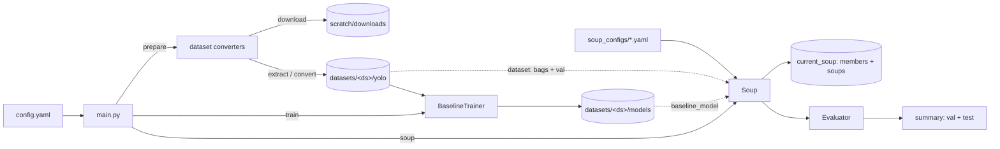
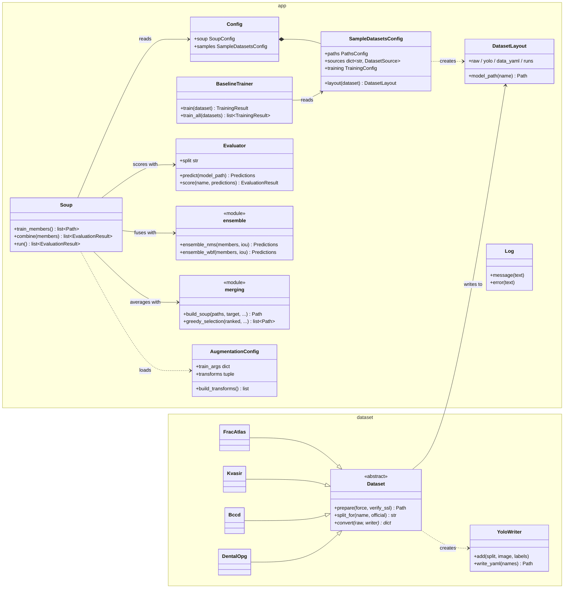

# Soup

## Overview

Soup is an experiment framework for *model soups* (averaging the weights of
several fine-tuned models) for Ultralytics YOLO object detectors. It downloads
example medical-imaging datasets, converts them to Ultralytics format, trains
a baseline detector per dataset, and fine-tunes that baseline into a set of
diverse *soup members*: each trained on a different random subset of the data
(bagging) with a different augmentation recipe. The members are then combined
by output ensembling (NMS and weighted boxes fusion), which serve as baselines,
and by weight averaging (uniform and greedy soups). Everything is compared on
the val and test splits, including how long each takes to validate. Choices
are made on val only, so test shows how well they hold up.

The four bundled datasets are examples; any dataset can be added by writing a
converter (see [Adding a dataset](#adding-a-dataset)).

## Requirements

- Python 3.15 in the `soup` conda environment.
- An NVIDIA GPU with CUDA for training (`soup.device` and `sample_datasets.training.device` in `config.yaml`).
- Pinned Python libraries are listed in `requirements.txt` (Ultralytics, PyTorch, Albumentations, PyYAML, certifi).
- Git LFS, if model or image files are ever committed (`.gitattributes` routes them to LFS).

## Setup

```bash
conda create -n soup python=3.15
conda activate soup
python -m pip install -r requirements.txt
git lfs install   # once per machine
```

## How to run

All commands run from the project root through `main.py`. Either activate the
environment (`conda activate soup`, then `python main.py ...`) or use
`conda run --no-capture-output` as below. Plain `conda run` holds back all
output until the command exits, so a long training run looks like it hangs.

```bash
conda run --no-capture-output -n soup python main.py prepare   # download and convert all datasets
conda run --no-capture-output -n soup python main.py train     # train baselines for sample_datasets.training.datasets
conda run --no-capture-output -n soup python main.py soup      # fine-tune and validate the soup members
```

Every command loads `config.yaml` first and logs the section it uses: `soup` for
`main.py soup`, and `sample_datasets` for `prepare` and `train`. All messages use the
format `[module] message`.

Outputs go under `scratch/` (git-ignored):

| Path | Contents |
|---|---|
| `scratch/downloads/` | Downloaded dataset archives |
| `scratch/weights/` | Pretrained Ultralytics weights (downloaded on first use) |
| `scratch/datasets/<dataset>/raw/` | Extracted archive |
| `scratch/datasets/<dataset>/yolo/` | Ultralytics dataset (`data.yaml`, `train/`, `val/`, `test/`) |
| `scratch/datasets/<dataset>/runs/<run_name>/` | Ultralytics training run (logs, plots, `weights/best.pt`) |
| `scratch/datasets/<dataset>/models/<run_name>.pt` | Published copy of the run's best checkpoint |
| `scratch/current_soup/bag<i>_<config>_e<epoch>.pt` | Soup members: one per checkpoint epoch of each fine-tune (`soup.output_dir`) |
| `scratch/current_soup/soup_uniform.pt`, `soup_greedy.pt` | Averaged soups, rebuilt on every run |

## Programs and command-line parameters

`main.py` is the only entry point. Its global option comes before the subcommand:

| Flag | Type | Required | Default | Description |
|---|---|---|---|---|
| `--config` | path | optional | `config.yaml` beside `main.py` | Configuration file; relative paths inside it resolve against its directory |

### `main.py prepare`

Downloads each dataset archive, extracts it to `raw/`, and converts it to
Ultralytics format in `yolo/`. An already prepared dataset is skipped. The
output directory is always rebuilt from empty, and an interrupted download or
extraction is redone automatically.

| Flag | Type | Required | Default | Description |
|---|---|---|---|---|
| `--dataset NAME` | string, repeatable | optional | every key under `sample_datasets.sources` | Dataset(s) to prepare |
| `--force` | flag | optional | off | Download again and rebuild from scratch |
| `--insecure` | flag | optional | off | Disable SSL certificate verification for the download |

```bash
conda run --no-capture-output -n soup python main.py prepare
conda run --no-capture-output -n soup python main.py prepare --dataset bccd --dataset kvasir
conda run --no-capture-output -n soup python main.py prepare --dataset fracatlas --force
```

Some dataset hosts (Kvasir in particular) can fail SSL verification behind
some networks. Use `--insecure` only if you trust the network, or set
`verify_ssl: false` for that dataset under `sample_datasets.sources` in `config.yaml`.

### `main.py train`

Trains a baseline detector for each selected dataset and logs a summary. For
each dataset it reports the epoch-1 val mAP50-95 and the train and val
mAP50-95 of the final `best.pt`, both measured on the same checkpoint. The run
trains into `runs/<run_name>-incomplete/`. Only after it succeeds does it
replace `runs/<run_name>/` and `models/<run_name>.pt`, so a failed run never
destroys an earlier baseline. One failed dataset does not stop the others. The
exit code is non-zero if any dataset failed.

| Flag | Type | Required | Default | Description |
|---|---|---|---|---|
| `--dataset NAME` | string, repeatable | optional | `sample_datasets.training.datasets` (or every source if that is empty) | Dataset(s) to train |

```bash
conda run --no-capture-output -n soup python main.py train
conda run --no-capture-output -n soup python main.py train --dataset dental_opg
```

### `main.py soup`

Fine-tunes the soup members from the baseline model `soup.baseline_model`
on the dataset `soup.dataset`, combines them, and evaluates everything on the
val and test splits.

Training steps:

1. For each of `soup.bagging_iterations` bags, a `soup.bagging_fraction`
   share of the training images is sampled without replacement, seeded by
   `soup.seed + bag number`.
2. Each bag is fine-tuned once per augmentation config in `soup.configs`.
   Fine-tuning uses the soup's `lr0`, `epochs`, `seed`, `optimizer`, `batch`,
   `imgsz`, `device`, `workers` and `amp`.
3. Every `soup.checkpoint_interval` epochs, and at the final epoch, the
   fine-tune's weights are saved as a separate member named
   `bag<i>_<config file stem>_e<epoch>.pt`. The shipped `config.yaml` (2 bags
   x 3 configs, 50 epochs, interval 10) gives 6 fine-tunes x 5 checkpoints = 30 members,
   which gives the greedy soup more to choose from. Checkpoints are taken at
   fixed epochs and never chosen by val score.
4. Mosaic stays on (at each config's `mosaic` probability) except for the
   last `soup.close_mosaic` epochs (default 2). Ultralytics' own default of 10
   would turn it off for the whole fine-tune. Fine-tunes also set
   `warmup_epochs: 0`. An augmentation config may override either. Per-epoch
   validation is off and each member keeps its last-epoch weights, so the val
   split is never used to pick a checkpoint.
5. Ultralytics run folders are written to a temporary directory next to
   `soup.output_dir` and deleted afterwards; only the member `.pt` files are
   kept. A fine-tune's checkpoints are saved to `soup.output_dir` as soon as
   it finishes.
6. A fine-tune whose checkpoints all exist in `soup.output_dir` is reused,
   not retrained, so an interrupted run carries on where it stopped. Deleting
   any of its checkpoints retrains that fine-tune and rewrites all of them.
   Bags are rebuilt from the same seed, so a retrained fine-tune sees exactly
   the same images. Existing files are not
   checked against the current settings: after changing `lr0`, `epochs`,
   `bagging_fraction`, an augmentation config, the baseline or the dataset,
   delete the old members (or choose a new `output_dir`) to retrain them.

Combining and validation steps, in table order:

1. **baseline** and each **member** are validated.
2. **ensemble/NMS** pools every member's detections per image and applies
   class-wise NMS at `soup.nms_iou`.
3. **ensemble/WBF** fuses every member's detections with weighted boxes
   fusion at `soup.wbf_iou`. Clustered boxes are confidence-weighted
   averages, and boxes found by few members are down-weighted.
4. **soup/uniform** averages all members' weights into one model, saved as
   `soup_uniform.pt` in `soup.output_dir`.
5. **soup/greedy** (Wortsman et al., 2022) ranks members by val mAP50-95,
   starts from the best, and adds each next member only if the averaged soup
   improves val mAP50-95. It is saved as `soup_greedy.pt`. Because it picks
   members on val, its val scores are optimistic; its test scores are the
   fair comparison.

After averaging, BatchNorm running statistics are re-estimated on
`soup.bn_recalibration_images` un-augmented training images (default 256; 0
keeps the averaged statistics). On dental_opg this raised the uniform soup's
mAP50-95 from 0.728 to 0.754.

The run ends with one summary table. Each row is a model or method. It
shows precision, recall, mAP50 and mAP50-95 on val and on test, each
macro-averaged (an unweighted mean over the classes present in that split),
plus the val time in seconds:

```
                    ------------- val --------------  ------------- test -------------
  model                  P       R   mAP50  mAP50-95       P       R   mAP50  mAP50-95  val time (s)
  ----------------  ------  ------  ------  --------  ------  ------  ------  --------  ------------
  baseline          0.9549  0.9476  0.9621    0.8359  ...
```

Only val scores are used to make choices; the test split is used for
reporting only. If the dataset has no test split, the test columns are left
out of the table.

Every model and method is scored the same way on both splits. Each model's
per-image predictions are captured from Ultralytics' own validator (conf 0.001, at most
300 detections), so single models reproduce `model.val()` exactly, and the
ensembles fuse exactly those predictions. The val time is the validator's
measured preprocess + inference + postprocess time over all val images,
excluding model loading and warm-up. For an ensemble it is the sum over all
members plus the fusion time, which is the cost of running it.

All models are validated with the soup's `imgsz`, `batch`, `device` and
`workers`. The soup section is self-contained: it does not read anything from
`sample_datasets`.

Ultralytics' console output is hidden throughout. While a member trains, a
single `[soup]` line shows the current epoch, batch and running mean losses,
and is updated in place. When the epoch ends the line is completed and a new
one starts for the next epoch. When a fine-tune finishes, one line gives its
bag size, epoch count, time taken and final training losses, and the next
lists the checkpoints it saved. For example:

```
[soup]  fine-tune 1/6 bag1_lighting epoch 1/50: 11 batches in 0m05s  box 0.951 cls 0.802 l1 0.012
[soup]  fine-tune 1/6 bag1_lighting epoch 2/50: batch 6/11  box 0.934 cls 0.790 l1 0.012   <- updating
...
[soup]  fine-tune 1/6 bag1_lighting: 666 images, 50 epochs in 4m07s, final train loss box 0.912 cls 0.774 l1 0.011
[soup]    saved .../scratch/current_soup/bag1_lighting_e{10,20,30,40,50}.pt
```

When output is redirected to a file, only the completed epoch lines are
written, without the in-place updates.

```bash
conda run --no-capture-output -n soup python main.py soup
```

### Configuration (`config.yaml`)

The file has two top-level sections. `soup` comes first and configures the
soup. `sample_datasets` holds everything about the example datasets and their
baseline training. Unknown sections and keys are rejected, so typos fail early.

| Section | Key | Meaning |
|---|---|---|
| `soup` | `baseline_model` | Path to the baseline `.pt` model, which can be anywhere (default config: the dental_opg baseline) |
| | `dataset` | Path to an Ultralytics `data.yaml`, or the directory containing it, which can be anywhere (default config: dental_opg). Splits may be image directories, image-list files or lists of these. `path:` keys and relative entries are resolved as Ultralytics does |
| | `output_dir` | Where soup members and the `soup_uniform.pt`/`soup_greedy.pt` soups are written (default `scratch/current_soup`) |
| | `lr0` | Fine-tune learning rate (default `0.002`) |
| | `bagging_fraction` | Share of training images per bag (default `0.8`) |
| | `bagging_iterations` | Number of bags (default `2`) |
| | `seed` | Bag sampling and training seed (default `42`) |
| | `epochs` | Fine-tune epochs (default `10`; the shipped `config.yaml` uses `50`) |
| | `close_mosaic` | Number of final epochs trained without mosaic (default `2`; `0` keeps mosaic on throughout) |
| | `checkpoint_interval` | Save a member every N epochs as well as at the final epoch (default `10`; `0` = final epoch only) |
| | `nms_iou` | IoU above which pooled boxes are suppressed in ensemble/NMS (default `0.7`) |
| | `wbf_iou` | IoU above which boxes are fused in ensemble/WBF (default `0.55`) |
| | `bn_recalibration_images` | Training images used to re-estimate BatchNorm statistics of averaged soups (default `256`; `0` = off) |
| | `optimizer`, `batch`, `imgsz`, `device`, `workers`, `amp` | Ultralytics settings for fine-tuning and validation. `imgsz` should match the baseline's training size |
| | `configs` | Augmentation config files (see below) |
| `sample_datasets.paths` | `downloads`, `datasets`, `weights` | Storage directories (see the outputs table above) |
| `sample_datasets.sources.<name>` | `url` | Archive download URL |
| | `verify_ssl` | Optional, default `true`; overridden by `prepare --insecure` |
| `sample_datasets.training` | `model` | Pretrained model; a bare `*.pt` name is stored in `sample_datasets.paths.weights` |
| | `optimizer`, `lr0`, `epochs`, `patience`, `batch`, `imgsz`, `device`, `workers`, `amp`, `seed`, `plots`, `verbose` | Passed to Ultralytics `train()`; `imgsz`/`batch`/`device`/`workers` are also used to evaluate `best.pt` |
| | `run_name` | Name of the run directory and published model file |
| | `datasets` | Sample datasets trained by default |

### Soup augmentation configs (`soup_configs/*.yaml`)

Each file defines one augmentation recipe and has two optional sections:

- `ultralytics`: Ultralytics `train()` hyperparameters such as `hsv_v`,
  `degrees`, `scale`, `perspective`, `bgr`, `mosaic`, `mixup` and `cutmix`.
  Keys controlled by `config.yaml` are rejected: `epochs`, `lr0`, `seed`,
  `optimizer`, `batch`, `imgsz`, `device`, `workers`, `amp`, `data`, and the
  run/output keys.
- `albumentations`: a list of Albumentations transforms, each written as
  `transform: <ClassName>` followed by that class's arguments. YAML lists
  become tuples. If present, they replace Ultralytics' built-in Albumentations
  defaults, which apply blur, median blur, greyscale and CLAHE at 1% each.

Every file is loaded and its transforms are built before any training
starts, so mistakes fail early.

| File | Simulates | Main augmentations |
|---|---|---|
| `lighting.yaml` | Exposure, contrast, colour temperature, uneven light | Strong HSV value/saturation, brightness/contrast, gamma, tone curve, Planckian jitter, CLAHE, shadows; mild geometry |
| `camera.yaml` | Different sensors and optics | Gaussian and ISO noise, motion and defocus blur, chromatic aberration, downscaling, JPEG compression, sharpening, greyscale, RGB/BGR swap, slight perspective; mild colour |
| `geometry.yaml` | Viewpoint, zoom, framing, clutter and occlusion | Rotation ±15°, shear, perspective, wide scale range, translation, mosaic, MixUp, CutMix; mild colour, default Albumentations |

## Example datasets

| Key | Source | Classes | Split |
|---|---|---|---|
| `fracatlas` | FracAtlas (Figshare), YOLO labels | fracture | Official CSVs for fractured images; hash 80/10/10 for the rest |
| `kvasir` | Kvasir-SEG (Simula), bbox JSON | polyp | Hash 80/10/10 |
| `bccd` | BCCD (GitHub), Pascal VOC XML | RBC, WBC, Platelets | Official ImageSets lists; hash 70/15/15 for unlisted images |
| `dental_opg` | Dental OPG v4 (Mendeley), COCO JSON or YOLO labels | 6 dental conditions | Split directories; hash 80/10/10 otherwise |

Hash splits are derived from the image name, so they are stable across rebuilds.

### Adding a dataset

1. Create `dataset/<name>.py` with a `Dataset` subclass. Set `key`, `archive_name`,
   and optionally `archive_type` (`"zip"` or `"tar"`) and `split_percentages`.
2. Implement `convert(raw, writer)`. Call `writer.add(self.split_for(name), image, label_lines)`
   for each image, using `yolo_box()` to build label lines from pixel boxes. Return the class names.
3. Register the class in `CONVERTERS` in `dataset/__init__.py` and add its `url` under `sample_datasets.sources` in `config.yaml`.

`YoloWriter` validates every label line. It rejects duplicate image names within a
split and class ids without a name, and it writes `data.yaml` with paths relative
to the YAML file.

## System diagram





`app/yolo.py` wraps the Ultralytics calls shared by `BaselineTrainer` and `Soup`:
loading a model with a clear error if Ultralytics is missing, suppressing its
console output, and reading class names.

## Project layout

```
main.py          Command-line entry point (prepare / train / soup)
config.yaml      All settings
soup_configs/    Augmentation recipes for soup members
app/             Configuration, logging, Ultralytics helpers, baseline training, and the soup:
                 soup.py (members, orchestration), evaluation.py (val scoring, tables),
                 ensemble.py (NMS/WBF), merging.py (weight averaging, greedy soup)
dataset/         Dataset base class, YOLO writer, and one converter per example dataset
scratch/         Downloads, datasets, runs, models and weights (git-ignored)
```
